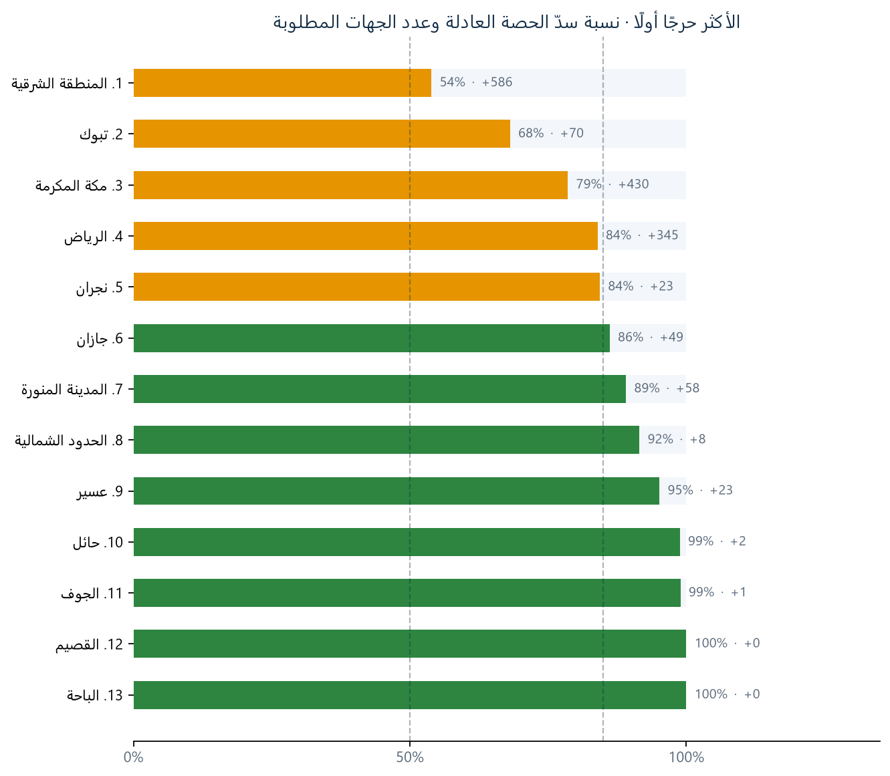
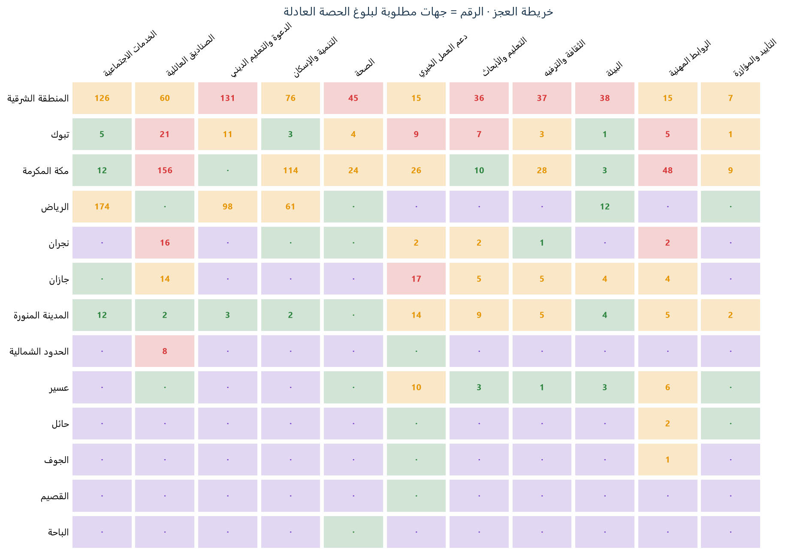
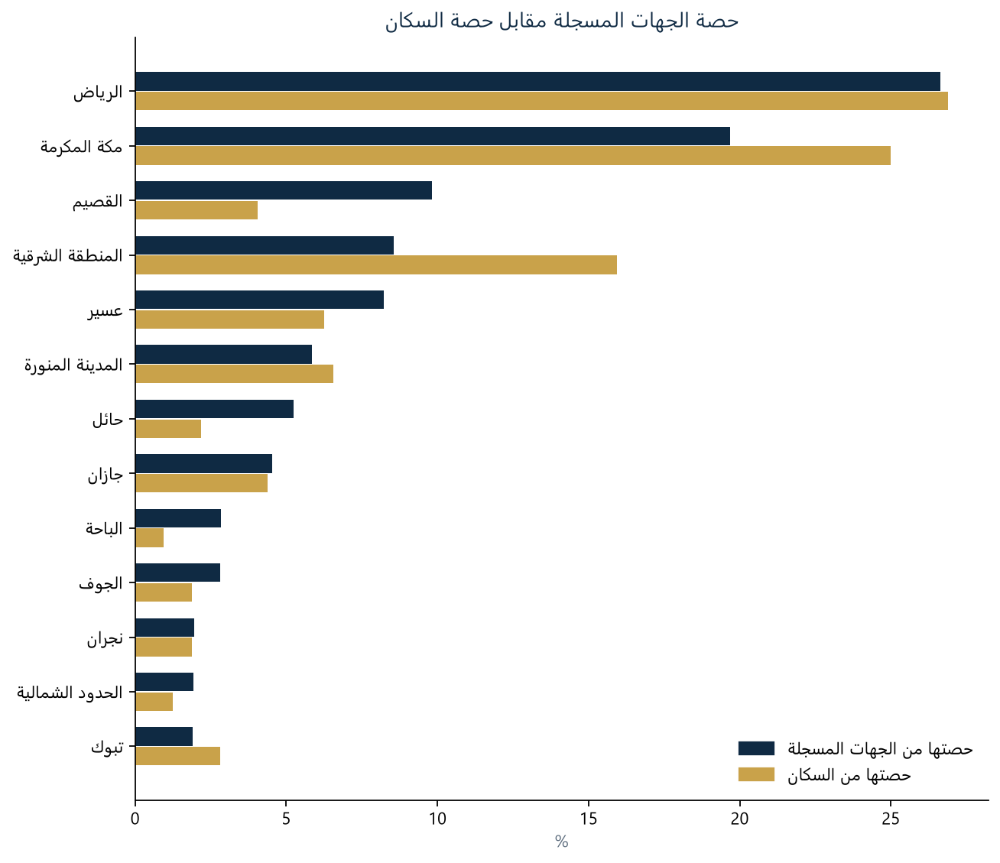
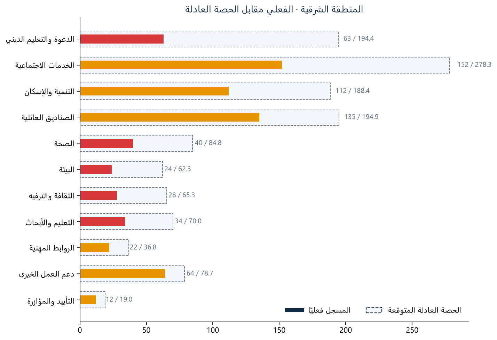

# GeoImpact KSA — التقرير التنفيذي

> أُنشئ تلقائيًا من مخرجات خط التحليل بتاريخ 2026-10-28 08:56.

## 1. الفكرة

لوحة قرار تفاعلية وخط تحليل قابل لإعادة التشغيل يقارنان التوزيع الجغرافي للجهات غير الربحية المسجلة (سجلات منصة نوى) مع حصة كل منطقة من سكان المملكة، لكل مجال من مجالات العمل، لرصد فجوات التوزيع وترتيبها بما يدعم توجيه التأسيس والدعم نحو المناطق والمجالات الأشد نقصًا.

**السؤال:** هل ينمو القطاع الثالث بتوازن بين مناطق المملكة ومجالات العمل، وكم جهة تحتاجها كل منطقة لتطابق حصتها من السكان؟

## 2. لماذا هذه الفكرة

- غالب الجهات غير الربحية تخدم نطاق منطقتها؛ فإذا كان مجال ما شبه غائب في منطقة، فقد يضطر سكانها إلى السفر بحثًا عن الخدمة أو الاستغناء عنها، لذا يهمّ قياس التنوع المحلي داخل القطاع لا العدد الوطني وحده.
- تستهدف [استراتيجية المركز الوطني لتنمية القطاع غير الربحي](https://www.vision2030.gov.sa/ar/explore/strategies/national-center-for-non-profit-sector-strategy) ضمن رؤية 2030 رفع مساهمة القطاع إلى 5% من الناتج المحلي؛ وهو مستهدف وطني يستدعي نموًا متوازنًا بين المناطق والمجالات، ويُستخدم هنا كسياق لا كهدف عددي لكل منطقة.
- أمثلة حقيقية من مخرجات هذا المشروع (أدنى نسب التغطية ضمن فئة «عجز حرج»):
- **تبوك — الروابط المهنية:** 1 جهة مسجلة مقابل حصة عادلة تقديرية 6.5 جهة (تغطية 15%).
- **جازان — دعم العمل الخيري:** 5 جهة مسجلة مقابل حصة عادلة تقديرية 21.6 جهة (تغطية 23%).
- **نجران — الصناديق العائلية:** 7 جهة مسجلة مقابل حصة عادلة تقديرية 22.9 جهة (تغطية 30%).
- هذه الفجوات إشارات تستحق التحقق الميداني (هل الخدمة غائبة فعلًا أم تغطيها جهات بديلة؟)، وليست إثباتًا لغياب الخدمة — كما تفصّله «حدود القراءة».

## 3. البيانات وطريقة التعامل معها

### المصادر

- **سجلات الجهات:** منصة نوى بعد التنظيف في دفتر `notebooks/cleaning_data.ipynb`، والناتج مصنف `Saudi_Charities_Governance_Final_2026.xlsx`.
- **السكان:** الهيئة العامة للإحصاء، [لوحة معلومات المناطق الإدارية](https://www.stats.gov.sa/ar/w/%D8%B9%D8%B1%D8%B6-%D9%85%D8%B9%D9%84%D9%88%D9%85%D8%A7%D8%AA-%D8%A7%D9%84%D9%85%D9%86%D8%A7%D8%B7%D9%82-%D8%A7%D9%84%D8%A5%D8%AF%D8%A7%D8%B1%D9%8A%D8%A9?category=127436&tab=436327)، ضمن إحصاءات تعداد السعودية 2022. القيم المستخدمة في الملف مقربة إلى 0.1 مليون.

### خطوات التعامل والتنظيف

- إسقاط الأعمدة الفارغة أو الحساسة (العنوان التفصيلي، الجوال، البريد الإلكتروني) وتطهير النصوص من الرموز غير المرئية والمسافات الزائدة.
- اعتماد `unifiedNumber700` مفتاحًا أساسيًا وحذف عمود `id` التالف؛ 8,012 سجلًا بمعرّف موحد فريد من أصل 8,012.
- توحيد أسماء المناطق (إضافة «منطقة» للأسماء المجردة، ومعالجة خاصة لـ«المنطقة الشرقية») لمطابقة جدول السكان.
- توحيد مسميات جهات الإشراف وإسناد القيم المفقودة بمسمى نظامي صريح بدل التخمين؛ وإشراف الصناديق العائلية مشتق من نوع الكيان ومُوسوم بذلك في البيانات (`supervisor_source`, `category_source`).
- **الخصوصية:** تفكيك حقل الأعضاء ثم الاحتفاظ بعددهم فقط (`members_count`)؛ لا تدخل بيانات الأفراد في أي مخرج.
- **المستبعد من المقارنة:** 22 جهة غير مصنفة، إضافة إلى سجلات «تصنيف أساسي أخرى».
- **حالة فحص الجودة:** `PASSED_WITH_WARNINGS`.

### حجم البيانات وتصنيفها

- **الحجم:** 8,012 سجلًا موزعة على 13 منطقة إدارية.
- **أنواع الكيانات:** جمعية أهلية: 6,108، صندوق عائلي: 1,223، مؤسسة أهلية: 681.
- **التصنيف:** 7,990 جهة مصنفة في 11 مجالًا، والصناديق العائلية مجال مستقل.

### سياق القطاع من التقرير السنوي 2025

- يذكر التقرير السنوي للمركز الوطني لتنمية القطاع غير الربحي أن الإنفاق التنموي بلغ **76.2%** من إجمالي إنفاق القطاع في **2024**، مقابل **75.3%** في **2023**.
- تجاوزت عمليات الفحص والمراجعة للمنظمات غير الربحية **2,300 عملية** في **2025**، ويعرض التقرير نموًا بنسبة **37%** مقارنة بـ **1,670 عملية** في **2024**.
- هذه مؤشرات وطنية مستقلة عن سجلات نوى؛ تُعرض للسياق فقط، ولا تدخل في حساب الحصة العادلة أو الفجوة، ولا تثبت توزيع الجهات أو الطلب أو جودة الخدمات. المصدر: [التقرير السنوي 2025 للمركز الوطني لتنمية القطاع غير الربحي](https://ncnp.gov.sa/ar/reports)، ص 18.

## 4. منهجية التحليل

1. **التحقق:** معرّف فريد لكل سجل، وأعمدة مطلوبة، وتوحيد أسماء المناطق مع جدول السكان (تعداد 2022).
2. **الحصة العادلة** لكل منطقة ومجال: `الحصة العادلة = إجمالي جهات المجال وطنيًا × (سكان المنطقة ÷ إجمالي السكان)`.
3. **الفجوة:** `الفجوة = الحصة العادلة − المسجل فعليًا`، وعدد الجهات المطلوبة هو الفجوة مقرّبة وغير سالبة.
4. **نسبة التغطية** = المسجل ÷ الحصة العادلة، وتُصنَّف بحدود 0.5 و0.85 و1.25:

| الفئة | نسبة التغطية |
|---|---|
| عجز حرج | أقل من 50% من الحصة العادلة |
| فجوة متوسطة | من 50% إلى أقل من 85% |
| متوازن | من 85% إلى 125% |
| تشبع | أعلى من 125% |

5. **نسبة سدّ المنطقة** تحسب كل مجال حتى حدّ حصته فقط، فلا يُخفي فائضٌ في مجال نقصًا في آخر. وبها تُرتَّب لوحة الأكثر حرجًا من الأسوأ إلى الأفضل.

## 5. النتائج

- المنطقة الأكثر حرجًا هي **المنطقة الشرقية**: تسدّ 54% من حصتها العادلة وتحتاج **586** جهة، وأشد مجالاتها نقصًا «الدعوة والتعليم الديني».
- إجمالي الجهات المطلوبة لبلوغ التوازن في كل المناطق: **1,595** جهة. عدد المناطق في العجز الحرج: **0**، ودون التوازن (حرجة أو متوسطة): **5**.
- أكبر منطقتين تسجيلًا (الرياض، مكة المكرمة) تضمان 46% من الجهات مقابل 52% من السكان.

### المناطق الأكثر حرجًا

| # | المنطقة | نسبة سدّ الحصة العادلة | جهات مطلوبة | مجالات حرجة | الأشد نقصًا |
|---|---|---|---|---|---|
| 1 | المنطقة الشرقية | 54% | 586 | 5 | الدعوة والتعليم الديني |
| 2 | تبوك | 68% | 70 | 4 | الصناديق العائلية |
| 3 | مكة المكرمة | 79% | 430 | 2 | الصناديق العائلية |
| 4 | الرياض | 84% | 345 | 0 | الخدمات الاجتماعية |
| 5 | نجران | 84% | 23 | 2 | الصناديق العائلية |

### المجالات

| المجال | جهات وطنيًا | جهات مطلوبة | مناطق في العجز الحرج |
|---|---|---|---|
| الخدمات الاجتماعية | 1,746 | 329 | 0 |
| الصناديق العائلية | 1,223 | 277 | 4 |
| الدعوة والتعليم الديني | 1,220 | 243 | 1 |
| التنمية والإسكان | 1,182 | 256 | 0 |
| الصحة | 532 | 73 | 1 |
| دعم العمل الخيري | 494 | 93 | 2 |
| التعليم والأبحاث | 439 | 72 | 2 |
| الثقافة والترفيه | 410 | 80 | 1 |
| البيئة | 391 | 65 | 1 |
| الروابط المهنية | 231 | 88 | 3 |
| التأييد والمؤازرة | 119 | 19 | 0 |

## 6. الرسوم البيانية

## 7. المخرجات

| الملف | المحتوى |
|---|---|
| `outputs/dashboard_data.json` | بيانات اللوحة المحسوبة مسبقًا |
| `outputs/entities.json` | فهرس بحث الكيانات بلا بيانات شخصية |
| `outputs/population_coverage_analysis.csv` | المقارنة بالحصة السكانية لكل منطقة ومجال |
| `outputs/gaps_analysis_report.csv` | مصفوفة التغطية الوصفية |
| `outputs/data_quality_report.json` | تقرير جودة البيانات |
| `outputs/figures/` | نسخ ثابتة من رسوم اللوحة |
| `dashboard/` | لوحة القرار التفاعلية |

## 8. حدود القراءة

- المؤشر يقارن **التسجيل** بحصة السكان؛ لا يثبت وجود طلب أو غياب خدمة، ولا يقيس جودة الخدمة.
- أرقام السكان مقرّبة إلى 0.1 مليون وتتأثر بها المناطق الصغيرة؛ مصدرها موضح في قسم البيانات.
- الصناديق العائلية وإشرافها مبنيان على قاعدة مشتقة من نوع الكيان، وليستا حقلًا مصدريًا.
- مناطق صغيرة السكان قد تُظهر عجزًا بأرقام صغيرة؛ يُفضَّل قراءتها مع نسبة السدّ لا العدد وحده.
